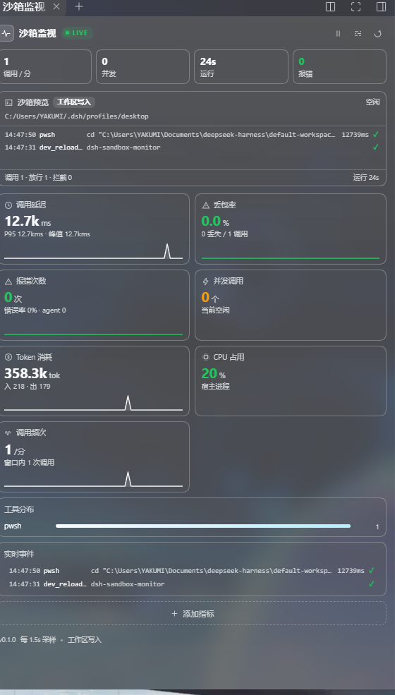
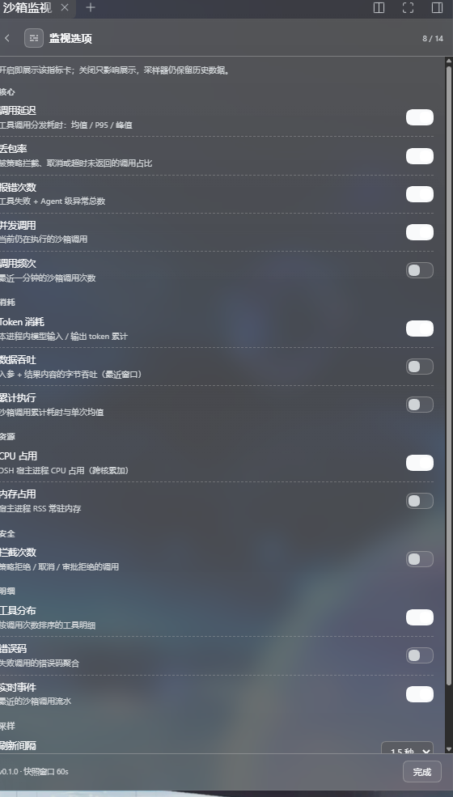

# dsh-sandbox-monitor

**DeepSeek Harness 沙箱实时监视器 —— 延迟、丢包、报错、资源消耗，全部挂进原生右侧栏。**

一块实时看板 + 一个终端风格的沙箱预览：不用猜，直接看沙箱此刻在干什么。

[English](./README.md)





## 为什么需要它

DSH 的工具调用都跑在沙箱里（PowerShell、读写文件、MCP……）。一旦变慢或静默失败，聊天里只剩一个最终结果。这个插件旁路采样工具管线，回答：

- 一次沙箱调用到底要多久？（均值 / P95 / 峰值，60 秒时序）
- 有多少调用被拦截、取消或超时？（丢包率）
- 到底什么在失败，错误码是什么？
- 这一轮花了多少？（Token、字节、CPU、内存）
- 哪个工具最吃资源？
- **现在**有什么正在跑？

## 功能

- **沙箱预览**：顶部实时终端，逐条显示最近调用（时间 / 工具 / 命令或路径摘要 / 耗时 / 状态），
  附当前沙箱模式（只读 / 工作区写入 / 完全权限）、根目录、运行时长、并发数。
- **14 个可选指标**：随时增减卡片，选择由宿主持久化。
- **实时事件流**：每条调用都带人类可读的参数摘要（命令、路径、pattern），不是干巴巴的 `ok`。
- **工具分布 / 错误码聚合**：按调用次数排序，附错误数与平均耗时。
- **跟随主题**：全部走 DSH 设计 token，明暗主题和玻璃皮肤自动适配。
- **零 schema 成本**：不注册 LLM 工具、不写 system prompt，采样完全旁路。
- **只在本地**：计数器在宿主进程内，配置在 `~/.dsh/sandbox-monitor/config.json`，不发任何网络请求、不埋点。

## 安装

需要带原生右侧栏（`@deepseek-ai/dsh-client-ui-sidebar-right`）的 DSH Web，已在 **0.2.0-rc.2** 上验证。

```bash
# 推荐
dsh plugin --profile web add github:wuming295/dsh-sandbox-monitor

# 或使用 release 压缩包
dsh plugin --profile web add https://github.com/wuming295/dsh-sandbox-monitor/releases/download/v0.1.0/dsh-sandbox-monitor-0.1.0.tgz
```

把 `web` 换成你的 profile 名（例如 `desktop`），然后刷新浏览器。

> npm 发布计划中；在此之前请用上面的 GitHub / release 方式安装。

### 从源码 / 不使用插件管理器

```bash
git clone https://github.com/wuming295/dsh-sandbox-monitor.git
cd dsh-sandbox-monitor
```

把目录挂到本地 DSH loader（例如 super-injector），或放进 profile 的 `node_modules` 并启用 bundle。
**没有构建步骤**——`lib/` 就是发布的 JavaScript。

## 入口

- **首次安装**会自动展开一次，不需要找。
- 之后：点左下角侧栏的波形按钮，或
- 右侧栏 → `+` → **沙箱监视**。

面板与当前会话无关：它展示整个宿主，而不只是当前对话。

## 指标口径

| 指标 | 含义 |
| --- | --- |
| 调用延迟 | 工具分发耗时：均值 / P50 / P95 / 峰值 + 60 秒时序 |
| 丢包率 | 被策略拒绝、取消、超时中止的调用占比 |
| 报错次数 | 工具失败 + Agent 级异常，附错误率与错误码 |
| 并发调用 | 当前正在执行的沙箱调用 |
| 调用频次 | 采样窗口内每分钟调用数 |
| Token 消耗 | 从 `assistant/message` usage 折叠的输入 / 输出 |
| 数据吞吐 | 入参 + 结果内容字节吞吐 |
| 累计执行 | 分发耗时累计与单次均值 |
| CPU | 宿主进程 CPU（跨核累加） |
| 内存 | 宿主进程 RSS / 堆 |
| 拦截次数 | 策略拒绝、取消、审批拒绝 |
| 工具分布 | 每个工具的调用数、错误数、平均耗时 |
| 错误码 | 失败调用错误码聚合 |
| 实时事件 | 实时调用流水 |

### 监视选项

点面板右上角滑杆：

- 任意指标开 / 关（默认开启 8 / 14）；
- 刷新间隔（1 秒 / 1.5 秒 / 3 秒 / 5 秒）；
- 清空当前计数器。

## 工作原理

宿主侧是纯旁路采样器，挂在：

- `tools/pre-execute` —— 策略决策（拒绝 / 取消）
- `tools/execute` —— 分发耗时与在途跟踪
- `tools/result` —— 错误、结果体积、最终状态
- `agent/error` —— Agent 级异常
- `session/event` —— assistant 消息的 token 用量
- `process.cpuUsage()` / `process.memoryUsage()` —— 宿主资源

所有 waterfall 钩子都原样 `next()` 并原样返回决策 / 结果，不改变调用语义。

客户端用 `sidebarRightTabs` 注册 tab 类型，把面板挂到 `sidebar.right.pane.tab`，
并在 `sidebar.footer.action` 放一个入口按钮；数据通过一个小型 JSON 端点轮询。

## HTTP 接口

```text
GET  /sandbox-monitor/api/snapshot
GET  /sandbox-monitor/api/health
POST /sandbox-monitor/api/config   { "enabled"?: string[], "refreshMs"?: number, "windowSec"?: number }
POST /sandbox-monitor/api/reset
```

## 配置

`~/.dsh/sandbox-monitor/config.json`：

```json
{
  "enabled": ["latency", "loss", "errors", "inflight", "tokens", "cpu", "tools", "events"],
  "windowSec": 60,
  "refreshMs": 1500,
  "maxEvents": 40
}
```

## 兼容性

- DSH Web，且启用原生右侧栏（`ui-sidebar-right`）。
- 已在 DSH `0.2.0-rc.2`（Windows 桌面版）验证。
- Node.js ≥ 20。
- 不需要打包器；客户端 bundle 是标准 `__ModuleLoader__` 模块。

## 开发

```bash
git clone https://github.com/wuming295/dsh-sandbox-monitor.git
cd dsh-sandbox-monitor
npm run check      # 两个半边的语法检查
npm pack --dry-run # 查看发布内容
```

- `lib/index.js` —— 宿主：采样、聚合、HTTP 路由、配置落盘。
- `lib/client.js` —— 客户端：右侧栏 tab、指标卡、监视选项页。
- `docs/` —— 截图。

欢迎 PR。请保持两边零依赖、只用主题 token。

## 许可

BSD-3-Clause © 2026 YAKUMI
